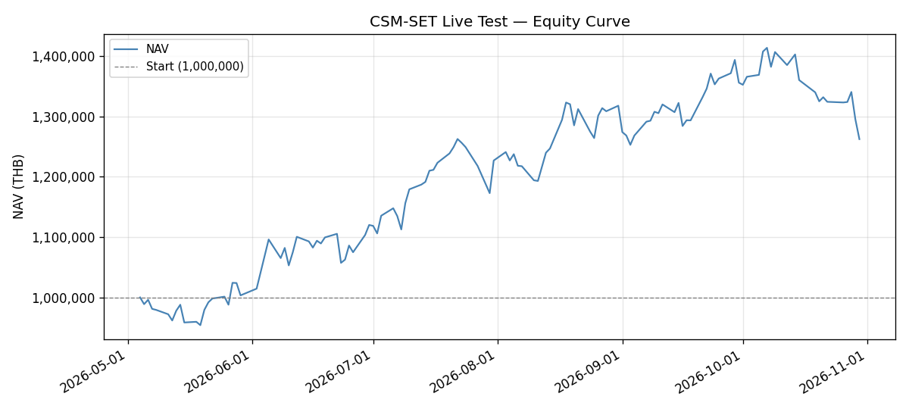
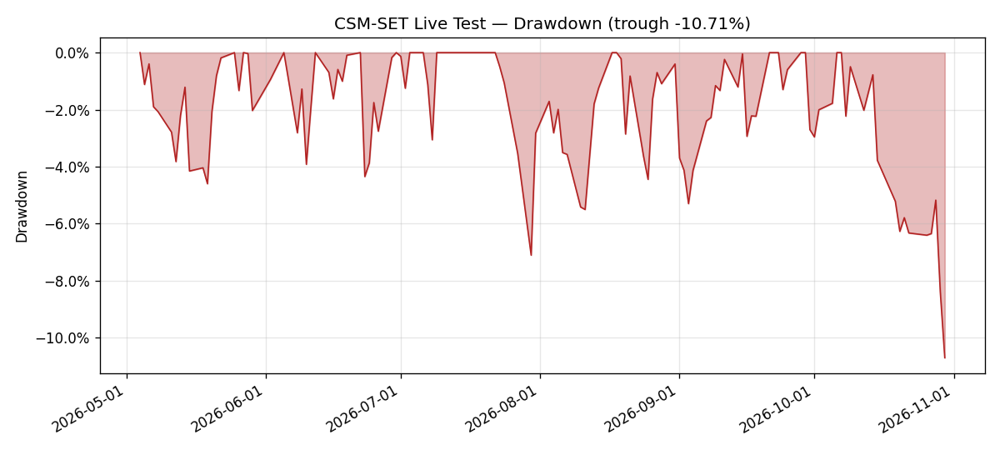
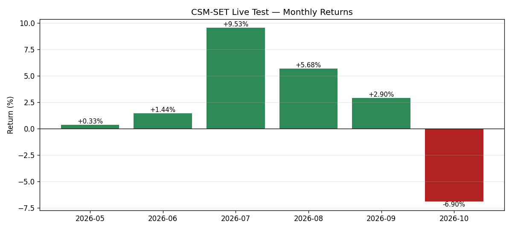
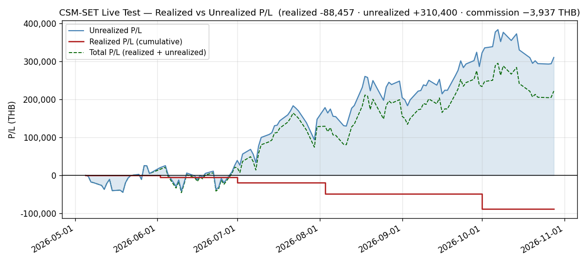

# Monthly Review — 2026-10 (October)

**Period:** October 2026 (live-test month 6, 19 trading days, Oct 1–30; market closures 2026-10-13, 2026-10-16 and 2026-10-23)
**Phase:** C — Stress Testing & Optimization (September–October). **October ends Phase C**; its reports are due with this month-end (Notes).
**Status:** 🟡 **REGISTERED, NOT YET SCORED — the first evaluation under the forward scoring pre-registration** (`reports/2026-10-27-forward-scoring-pre-registration.md`, `cc7bcb1`; confirmed *"keep"* 2026-10-29, `4606aa4`). The 2026-10-30 close is the scored window's anchor, **NAV₀ = 1,262,159.89 THB**; October itself is pre-registration history, seen and not scored. NAV closed October **−93,611.81 (−6.90%)** with no capital flow, the first losing month of the live test. Cumulative return on the 1,120,000 base is **+12.69%**. 🔴 **The circuit breaker tripped at the evaluation close** (rolling drawdown −10.71%; `events/2026-10-30-circuit-breaker-trip.md`). Under the registration, **the book is scaled to 20% equity at the 2026-11-02 ATO**. The rules also rotate **2-out / 2-in**: SELL EASTW and FORTH, BUY SPRC and RCL, then scale everything to 20%. **The plan rests on five points of interpretation the registration did not spell out (I1–I5, Rebalance); the operator should confirm or correct them before the ATO.**

---

## Executive Summary

October ran **1,355,771.70 → 1,413,483.89 (all-time high, 10-07) → 1,262,159.89 (low, the close)**: +4.26% to the high in five sessions, then −10.71% over the next fourteen. **9 sessions rose and 10 fell.** The largest single-session gain was **+38,594.00 (10-06)** and the largest loss **−45,481.00 (10-29)**. The last two sessions alone lost **−78,173.00**.

**Only one name gained over the month.** SMT added **+23,460.00** while every other position lost:

| Name | Contribution (THB) |
|---|---:|
| EASTW | −24,960.00 |
| KCE | −19,500.00 |
| HANA | −17,250.00 |
| GUNKUL | −14,168.00 |
| IRPC | −13,584.00 |
| INSET | −12,600.00 |
| FORTH | −6,890.00 |
| CNT (since its 10-01 entry, fees included) | −6,290.12 |
| EPG | −1,730.00 |
| MGC (the sell fee at the 10-01 ATO) | −99.69 |

The contributions sum to the month's −93,611.81 exactly.

**The month's decisive event is a rule firing, not a return.** At the 2026-10-30 close the 60-session rolling drawdown reached **−10.7057%**. That passes the design breaker's −10% trigger, and the registered procedure returned **TRIPPED** at the first evaluation it governs. **The SET also closed −3.22% below its own EMA100**, the index-overlay condition. It is reported, not applied (registration §4).

---

## Performance Metrics

| Metric | Value | Target / Baseline | Status |
|---|---:|---|---|
| Month-open NAV (Sep 30 close) | 1,355,771.70 | — | — |
| Month-close NAV | **1,262,159.89** | — | matches the 2026-10-30 daily log exactly |
| Month change | **−93,611.81 (−6.90%)** | — | no capital flow (D2) |
| **Time-weighted return** | **−6.90%** | — | equals the reported change (no flow) |
| Cumulative return (1,120,000 base) | **+12.69%** | — | — |
| Annualized Sharpe (flows stripped, n=121) | **1.0451** | ≥ 0.5 | on the TK-0568 basis; 1.8276 at 2026-09-30 |
| Realized volatility — since inception | **28.35%** ann. | ≤ 15% (warn > 20%) | 🔴 breached, as throughout the live test |
| Realized volatility — October | 1.69% daily (**26.76%** ann.) | ≤ 15% | 🔴 above target; on the `daily_performance` basis of the since-inception row (26.86% on the published series, which differs only on 10-01) |
| Max drawdown since inception | **−10.71%** (2026-10-30) | > −15% | 🔴 **a new low**, past the −10% breaker trigger (was −7.11%) |
| October max drawdown | **−10.71%** (10-30 vs the 10-07 peak) | — | 🔴 |
| Up / down sessions | **9 / 10** | — | — |
| Turnover — October executed | **4.43%** one-way (the 10-01 MGC → CNT rotation) | — | — |
| **Turnover — November plan** | **42.66%** one-way · **85.32%** two-sided | PLAN: Σ\|Δw\| × 12 / months ≤ 150% | the breaker scaling |
| Sector concentration (max) | **ETRON 37.0766%** (10-28); 36.5548% at close | ≤ 35% | 🔴 accepted known violation (D2) |
| Position bound | INSET **14.7515%** (max, 10-09) · CNT **4.0948%** (min, 10-15) | 5–15% | 🔴 CNT below the floor (D2) |
| Data completeness | **19/19** sessions | ≥ 95% | ✅ held data complete on all 19 |

**On the Sharpe and volatility figures.** Both are computed the way [[TK-0568]] corrected them: `db_gateway.daily_performance` from 2026-05-04, the two capital injections stripped from their days' returns, sample standard deviation, × √252. ⚠️ That series holds the **pre-trade** mark for 2026-10-01 (1,354,596.70), while the published log and `equity_curve` hold the post-trade 1,352,210.89. On the published series the two figures read **1.0447** and **28.36%**; the month-end NAV is the same on both.

**From November these figures are superseded for scoring** by the registration's own series and formulas: the published daily-log NAV from NAV₀, and rf = 2% (§5).

---

## Performance vs Backtest Baseline

> 🔴 **Context for continuity, NOT a scored comparison.** October is pre-registration history. The table states the backtest's figures beside the live ones because the procedure requires the section. It does not claim that either outperforms the other.

| Measure | Live (6 months) | Phase 3.8 real-data backtest | Read |
|---|---:|---:|---|
| Return | +12.69% cumulative | CAGR **12.52%** | a 6-month window against a multi-year walk-forward — not comparable |
| Sharpe | 1.0451 (n=121) | **0.663** | not comparable at this sample size |
| Max drawdown | **−10.71%** | **−31.03%** | the first drawdown past the breaker's trigger |
| Turnover | 4.43% (Oct), 42.66% one-way (Nov plan) | ≤180% p.a. | inside |

From the scored window on, **criterion 4 measures against Phase 3.8 pro-rated** (registration §6 #4, [[TK-0570]], closed 2026-10-29). The caveats it requires wherever that baseline is quoted still apply: Phase 3.8 is a different configuration (the broad book, with no per-holding EMA100 exit and no concentrated 10-name sizing); its cost model is the flat 15 bps the audit found too low, not recomputed; and the ±5pp band was calibrated neither across configurations nor for a 41-session window.

---

## Rebalance (November 2 ATO)

**Evaluation date:** 2026-10-30 (October's last trading day). **Execution date:** 2026-11-02 (Monday) ATO — a trading session by the banked SET holiday calendar (`captured_at 2026-10-30T10:50:09Z`), whose next 2026 closure is 2026-12-07.

### Ranking inputs (reproduced from the engine)

- **Composite:** the equal-weight mean of the six z-scored factor columns (`mom_12_1`, `mom_6_1`, `mom_3_1`, `mom_1_0`, `sharpe_momentum`, `residual_momentum`); percentile rank is `composite.rank(pct=True)`.
- **The verdict was produced by calling `PortfolioConstructor.select()` itself** (n=10, floor 0.35, buffer 0.25), as registered (§4).
- **204 ranked symbols** at 2026-10-30, from `features_latest.parquet` as written by that day's scheduled refresh (211 fetched, `failures=0`, `index_fetched=true`), with no missing factor values.
- **The engine was imported without the host's `.env`:** run from a directory with no `.env`, with public mode on and DB writes off.
- **EMA100:** `ewm(span=100, adjust=False, min_periods=100)` of each close in `prices_latest.parquet`, the registered per-holding construction.

### Current holdings — at the 2026-10-30 close

| Holding | Universe rank | Pct-rank | Below 0.35 floor? | Challenger gap ≥ 0.25? | Close < own EMA100? |
|---|--:|--:|---|---|---|
| SMT | 1 | 1.0000 | no | no (−0.0098) | no (7.20 vs 5.3897, +33.59%) |
| CNT | 2 | 0.9951 | no | no (−0.0049) | no (3.00 vs 2.5778, +16.38%) |
| KCE | 4 | 0.9853 | no | no (+0.0049) | no (68.75 vs 56.3047, +22.10%) |
| IRPC | 9 | 0.9608 | no | no (+0.0294) | no (2.60 vs 2.4820, +4.76%) |
| GUNKUL | 12 | 0.9461 | no | no (+0.0441) | no (4.64 vs 4.6374, +0.06%) |
| INSET | 15 | 0.9314 | no | no (+0.0588) | no (4.30 vs 4.2227, +1.83%) |
| HANA | 17 | 0.9216 | no | no (+0.0686) | no (45.25 vs 43.5918, +3.80%) |
| EPG | 20 | 0.9069 | no | no (+0.0833) | no (6.00 vs 5.8195, +3.10%) |
| **FORTH** | 49 | 0.7647 | no | no (+0.2255) | **YES (13.30 < 14.1058, −5.71%)** |
| **EASTW** | 66 | 0.6814 | no | **YES (+0.3088)** | **YES (4.16 < 4.6410, −10.36%)** |

**The rule verdicts:**

| Rule | Verdict |
|---|---|
| `PortfolioConstructor.select()` | **EASTW evicted, 9 retained.** The best eligible challenger is **SPRC at 0.9902** (#3), so the buffer bites below **0.7402**. EASTW at 0.6814 is under it; FORTH at 0.7647 clears it by **+0.0245**. The seven-factor reading also evicts only EASTW, but its order below SPRC differs (RCL is #11 there, not #7); the registration fixes the six-factor reading. |
| EMA100, per holding | **EASTW and FORTH sell.** GUNKUL holds by **+0.06%** (4.64 against 4.6374). |
| Circuit breaker | **TRIPPED** (−10.7057%, equity fraction 0.20), so the whole constructed book scales to 20% equity. |
| Index overlay (reported, not applied) | **Condition met.** The SET at **1,518.59** is **−3.22%** below its EMA100 of 1,569.1037 (`is_bull_market(window=100)` returns **False**) inside a BULL regime: +0.24% above the engine's EMA200 of 1,514.9974, and +0.37% above the daily logs' SMA200. Not applied (registration §4). |

### Construction — 2-out / 2-in, before scaling

**Exits:**
- **EASTW** — buffer (+0.3088) and EMA100 (−10.36%). 24,000 shares at 4.16 gross 99,840.00.
- **FORTH** — EMA100 (−5.71%). 5,300 shares at 13.30 gross 70,490.00.

Net of the 0.16799% fee, plus 1,377.89 cash, **171,421.75 THB** is available, 85,710.88 per entrant (current proceeds-plus-cash practice, §8).

**Entrants**, from the top of the ranking, skipping holdings, with the ≥ 5M THB 63-day ADTV floor and the 35% cap checked on SET-official sectors:

| Rank | Name | Sector | 63-day ADTV | Close vs own EMA100 | ENERG at construction with it | Verdict |
|--:|---|---|--:|--:|--:|---|
| 3 | **SPRC** | ENERG | 473.75M | +13.51% | 29.7730% | ✅ **enters** |
| 5 | SSP | ENERG | 30.89M | +30.14% | 36.5638% | ❌ skipped — ENERG over 35% |
| 6 | BBGI | ENERG | 20.49M | +12.61% | 36.5638% | ❌ skipped — ENERG over 35% |
| 7 | **RCL** | TRANS | 265.13M | +22.89% | — (TRANS 6.7908%) | ✅ **enters** |

At construction size the entrants would be **SPRC 6,200** and **RCL 1,700** shares.

### Scaling — the circuit breaker's 20% equity

Every position of the constructed book is multiplied by **0.20**, as `DrawdownCircuitBreaker.apply` multiplies the weights it is given. Shares are **floored to the 100-share board lot**, so equity does not exceed 20%.

**Trade list (2026-11-02 ATO), indicative prices at the 2026-10-30 close:**

| Side | Symbol | Shares | Keep after | Indic. price | Gross (THB) | Rule |
|------|--------|-------:|-----------:|-------------:|------------:|------|
| SELL | EASTW | 24,000 | 0 | 4.16 | 99,840.00 | buffer + EMA100 exit |
| SELL | FORTH | 5,300 | 0 | 13.30 | 70,490.00 | EMA100 exit |
| SELL | INSET | 33,600 | 8,400 | 4.30 | 144,480.00 | breaker: to 20% |
| SELL | KCE | 2,100 | 500 | 68.75 | 144,375.00 | breaker: to 20% |
| SELL | SMT | 16,400 | 4,000 | 7.20 | 118,080.00 | breaker: to 20% |
| SELL | IRPC | 45,300 | 11,300 | 2.60 | 117,780.00 | breaker: to 20% |
| SELL | GUNKUL | 24,700 | 6,100 | 4.64 | 114,608.00 | breaker: to 20% |
| SELL | HANA | 2,400 | 600 | 45.25 | 108,600.00 | breaker: to 20% |
| SELL | EPG | 13,900 | 3,400 | 6.00 | 83,400.00 | breaker: to 20% |
| SELL | CNT | 14,600 | 3,600 | 3.00 | 43,800.00 | breaker: to 20% |
| BUY | SPRC | 1,200 | 1,200 | 13.60 | 16,320.00 | entrant (#3), at 20% |
| BUY | RCL | 300 | 300 | 50.25 | 15,075.00 | entrant (#7), at 20% |

**Totals at indicative prices:**

| | Value |
|---|---|
| Sales | **1,045,453.00** gross |
| Purchases | **31,395.00** gross |
| Fees | **1,809.00** (sell 1,756.26, buy 52.74) |
| Cash after | **1,013,626.89** |
| Equity after | **246,724.00, 19.5478% of NAV** |
| NAV after | **1,260,350.89** (the fees are the only change) |

**Liquidity:** no sale exceeds **0.46%** of its name's 63-day ADTV (EASTW, 99,840.00 against 21.92M). The thinnest held name, CNT at 9.78M, sells 43,800.00 (0.45%). The largest sale by value, INSET's 144,480.00, is 0.32% of its 45.37M.

**Resulting book (indicative, SET-official sectors):**

| Sector | % of NAV |
|---|---:|
| ETRON (KCE, HANA, SMT) | 7.1564% |
| ENERG (GUNKUL, IRPC, SPRC) | 5.8633% |
| ICT (INSET) | 2.8618% |
| CONMAT (EPG) | 1.6163% |
| TRANS (RCL) | 1.1944% |
| CONS (CNT) | 0.8557% |

Every position is between 0.86% and 2.86% of NAV, **below the 5% floor**. §8 binds the bands at construction on the names being traded, and every name trades here, so the floor and the breaker conflict on this book. **This plan lets the breaker govern (I5).**

**Realized P/L and commission if the trades fill at the indicative prices:**

| Name | Realized (THB) |
|---|---:|
| KCE | +62,094.91 |
| GUNKUL | +42,177.85 |
| INSET | +40,588.01 |
| SMT | +22,602.56 |
| HANA | +22,480.76 |
| IRPC | +13,224.53 |
| EPG | +1,112.29 |
| EASTW | −2,740.52 |
| CNT | −5,119.34 |
| FORTH | −15,101.52 |
| **Total** | **+181,319.53** |

- **Cumulative realized** moves from −88,456.67 to **+92,862.86 THB**.
- **Cumulative commission** moves from 3,936.97 to **5,745.97 THB**.
- **Record the executed figures from the broker confirmations, not these.**
- `configs/live_portfolio.yaml` is **not** edited by this review. It changes only after the fills, with commission-inclusive `avg_cost` at 4 decimals for the two entrants, the new share counts and the new cash.

### 🔴 For the operator before the ATO — five points of interpretation

The registration fixed the rules. It did not spell out how a TRIPPED breaker combines with a rotation. **This plan reads it as below. If any reading differs from what was intended, say so before the 2026-11-02 ATO:** a reading chosen after the fills would be chosen by outcome.

| # | Point | This plan | The alternative |
|---|---|---|---|
| I1 | Entrants while TRIPPED | **bought at 20% of their construction size** (SPRC 1,200, RCL 300), as the engine scales the target weights it is given | no entrants while TRIPPED; their 20% stays in cash |
| I2 | When the 35% sector cap is checked | **on the constructed book, before scaling** (§4: "checked at construction"), so SSP and BBGI are skipped and RCL enters | on the scaled book, where no sector can reach 35%; SSP would enter instead of RCL |
| I3 | Rounding | **floor to the 100-share lot**, so equity is at most 20% (19.5478%) | round to the nearest lot (equity could exceed 20% slightly) |
| I4 | How the breaker's state advances | **once per session**, threaded through the daily logs, so "recovery held for 21 sessions" means 21 sessions. Trades happen only at month-end evaluations | once per monthly call, which would make the class's 21-call confirmation take 21 months |
| I5 | The 5–15% position band on a scaled book | **the breaker governs**: every name keeps about 20% of its constructed size (0.86–2.86% of NAV), as `DrawdownCircuitBreaker.apply` scales each weight | keep the 5% floor by holding at most four names inside the 20% equity; the registration names no rule for choosing which |

### What the trip means for the scored window

**Recovery needs the 60-session rolling drawdown back above −5%.** The 2026-10-07 peak (1,413,483.89) stays inside the window through 2026-12-30, 55 sessions after it, so NAV would have to reach **1,342,809.70**. From a book about 80% in cash, that needs the equity sleeve to rise by roughly a third.

**The scored window will very likely be run in safe mode**, and its return, volatility, drawdown and Sharpe will describe a mostly-cash book. The registration's §9 power statement applies with extra force, and criterion 8's trip path is now exercised.

---

## P/L Split

| Metric | This month | Since inception |
|--------|----------:|----------------:|
| Realized P/L | **−39,365.29** | **−88,456.67** |
| Unrealized P/L | **−54,246.32** | **+232,227.03** |
| **Total P/L** | **−93,611.61** | **+143,770.36** |
| Commission paid | **−201.81** | **−3,936.97** |

- **Realized moved once, at the 2026-10-01 rotation.** MGC was sold by the per-holding EMA100 exit for −39,365.29.
- **Commission ledger:** 1,611.15 (05-05) · 984.44 (06-02) · 169.09 (06-04/05) · 287.83 (07-01) · 682.65 (08-03) · 201.81 (10-01) = **3,936.97** cumulative.
- **Commission is already inside the other rows** — buy-side capitalised into cost basis, sell-side netted out of realized. Never subtract it from NAV a second time.
- **Quote commission against both denominators.** 3,936.97 is **0.31% of NAV** and **4.45% of the 88,456.67 cumulative realized loss**.
- **Total P/L fell −93,611.61**, which is the NAV change (−93,611.81) plus the +0.20 residual step at the rotation. **It is the first month-end at which the total stands below the previous one**, and the breaker's response is the scaling above.

**P/L identity:** `realized_cum + unrealized − (NAV − starting_nav)` = −88,456.67 + 232,227.03 − 142,159.89 = **1,610.47 THB**, constant on every session from 2026-10-01. It stepped **+0.20** at the rotation by CNT's 4-dp `avg_cost` rounding. It may step again at the November rotation by the entrants' rounding.

---

## Drawdown & Risk

| Metric | Value | Threshold | Status |
|---|---:|---|---|
| Drawdown at month-close | **−10.71%** (vs the 10-07 peak 1,413,483.89) | — | 🔴 |
| October max drawdown | **−10.71%** (10-30) | — | 🔴 |
| Max drawdown since inception | **−10.71%** (2026-10-30) | > −15% | 🔴 past the breaker trigger |
| **Circuit breaker (design rule)** | **TRIPPED** at the 10-30 close | −10% over 60 sessions | 🔴 **book to 20% equity at the ATO** |
| The 1,064,000 line (5% below `starting_nav`) | NAV **+198,159.89 / 15.70%** above | reporting only (registration §6 #8) | — |
| Sector concentration | **ETRON 36.5548%** at close (max 37.0766%, 10-28) | ≤ 35% | 🔴 accepted known violation (D2) |
| Sector / position floor | **CNT 4.3259%** | ≥ 5% | 🔴 accepted known violation (D2) |
| Position ceiling | INSET **14.3088%** at close (max 14.7515%, 10-09) | ≤ 15% | ✅ inside |
| Liquidity | thinnest held CNT **9.78M**; entrants SPRC **473.75M**, RCL **265.13M** | ≥ 5,000,000 THB | ✅ |

**The October book's two known violations (D2) were carried all month and never traded**, by the registered reading that bounds bind at construction on traded names ([[TK-0279]], confirmed 2026-10-29). **The November rotation removes the ETRON excess** by scaling (ETRON falls to 7.16%). **It does not cure the floor breach:** CNT falls to 0.86%, and every name lands below the 5% floor (I5).

**The two large sleeves (ENERG, ETRON) held 67.43–68.46% of NAV on every October session.** ENERG's three names lost **−52,712.00**, more than half the month's −93,611.81. ETRON's lost −13,290.00 net, SMT's +23,460.00 against KCE and HANA. The realized volatility since inception is 28.35% against a 15% target. **The vol-scaling overlay is not applied in the live test** (registration §4).

---

## Regime Summary

| Indicator | Sep 30 | Oct 30 | Change |
|---|---:|---:|---|
| SET Index | 1,559.01 | **1,518.59** | −40.42 (**−2.59%**) |
| SET 200-day SMA | 1,484.1103 | **1,512.9322** | +28.8219 (+1.94%) |
| Cushion (SET vs SMA200) | +5.05% | **+0.37%** | **−4.67 pp** |
| Regime | BULL | **BULL** | no transition |
| SET vs its EMA100 (index overlay, reported only) | −0.73% | **−3.22%** (1,518.59 vs 1,569.1037) | below at both evaluations |

- **No regime transition occurred.** The book was in BULL on all 19 sessions.
- **At the close the SET is 5.66 points (−0.37%) from its SMA200**, the narrowest cushion since 2025-09-04, on bars back to 2024-09-06.
- **The SET's margin over its EMA100 at each month-end evaluation:** +9.00% (05-29), +7.27% (06-30), +6.04% (07-31), +2.46% (08-31), −0.73% (09-30), **−3.22% (10-30)**.
- **Under the registration the index overlay is not applied**, so its condition being met again changes nothing. The per-holding rule and the breaker are the rules that act.

---

## Charts

**All four are current to 2026-10-30.**

- `nav_actual.csv` and `nav_twr.csv` were extended **102 → 121 rows**, and **the 102 previously committed rows are byte-identical** in both.
- The three NAV charts were regenerated by the documented two-run recipe.
- `pnl_realized_unrealized.png` is the one the 2026-10-30 daily log regenerated from `pnl.csv` (121 rows).

**Verified against the rendered images, before publishing:**
- the monthly-returns bars read **May +0.33% · Jun +1.44% · Jul +9.53% · Aug +5.68% · Sep +2.90% · Oct −6.90%**, the five prior bars identical to the published values;
- October carries no capital flow, so the TWR bar and the actual-NAV figure agree;
- the equity curve ends at **1,262,159.89**, and the drawdown chart's trough label reads **−10.71%**.

⚠️ **Which source the October rows came from.** The 19 October rows are the **published** daily-log NAVs. They equal `equity_curve` on every session, and equal `daily_performance` on every session but 2026-10-01: `daily_performance` holds the pre-trade 1,354,596.70 there, while the log and `equity_curve` hold the post-trade 1,352,210.89. The TWR rows are the same values × `k₁ × k₂` (0.9087563918 × 0.9839712855), neither factor re-derived; October has no capital flow. **Control:** the factor reproduces the committed 2026-09-30 TWR row, 1,212,317.76, exactly. Recorded in `graphs/README.md`.

---

## Significant Events

One new event report, the first circuit-breaker trip:

- [`events/2026-10-30-circuit-breaker-trip.md`](../events/2026-10-30-circuit-breaker-trip.md) — the design breaker trips at the evaluation close, so under the registration the book is scaled to 20% equity at the 2026-11-02 ATO.

**No regime transition occurred**, so no regime event is filed. The index-overlay condition was met at the close; the breaker report links the existing EMA100 report (`events/2026-09-30-ema100-fast-exit-definition-conflict.md`) instead of a new one being filed.

---

## Notes / Data Quality

**Infrastructure.**

- 🟢 **19 of 19 scheduled refreshes fired on time**, none manually triggered.
  - Held-symbol data was complete on all 19 (`held_symbols_failed=0` in every log). No log exists for the three closures (10-13, 10-16, 10-23), which the banked SET calendar lists.
  - **The host rebooted twice on the morning of 2026-10-06**, both clean shutdowns in its own record. The container restarted with it, was not recreated, and that day's firing ran.
- 🟢 **`:8100` is bound to loopback** since the 2026-10-27 06:15 BKK recreate (`8307ab3`).
- 🟢 **The image was rebuilt three times for dependency updates.**
  - Deployed 2026-10-14 19:32 BKK (`e71f1e0b9d6c`, lock `b1fdf98`), 2026-10-27 21:49 BKK (`15cde7c84ca4`) and 2026-10-28 20:49 BKK (`e56ad7660dd4`). The first scheduled refresh after each ran clean.
  - A third lock update (`89ad35b`, 2026-10-29) is deferred until after the 2026-11-02 ATO by operator choice. The evaluation's refresh was therefore the second on `e56ad7660dd4`; the first, on 2026-10-29, also ran clean.
- 🟢 **The forward scoring pre-registration** was committed on 2026-10-27 and confirmed *"keep"* on 2026-10-29. No amendment was made.

**Data and reporting defects, carried.**

- **The uncredited dividend total holds at 8,927.00 THB.** The registration leaves dividends uncredited in the scored series (§8).
- **`daily_performance` and `equity_curve` disagree on 2026-10-01 by 2,385.81, by design** (pre-trade against post-trade). The chart series uses the published value.
- **The strategy still reports zero trades and zero commission to the platform** ([[TK-0565]]). The November rotation will be the sixth recorded only in prose unless that is fixed first.

**Phase C — the phase ends with this month.** Its two reports are not yet written:

| Report | Exit criterion | Note |
|---|---|---|
| `reports/slippage-audit.md` | C.2 | should include the November rotation's fills: at indicative prices its fees (1,809.00) exceed the 2026-05-05 entry's 1,611.15, the largest rotation to date ([[TK-0571]]) |
| `reports/parameter-review.md` | C.3 | with the breaker trip, the vol target and the EMA100 definitions as live evidence |

C.1's per-event reports are filed for every event the daily logs flagged (`events/`). Whether that meets C.1's exit criterion, *"event analysis complete for all major market events"*, belongs to the Phase C close-out.

**Open decisions carried into November:**

1. 🔴 **I1–I5** above — *before the 2026-11-02 ATO*.
2. The wider band policy ([[TK-0279]]), dividend accrual and the history question: answered for the scored window by §8, and open beyond it.
